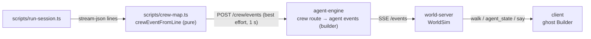

# Design Document: build-crew

## Overview

No new transport. The engine already streams agent events to the world-server, and the sim already turns `agent.goto`, `agent.state_changed` and `agent.say` into visible actions. The only new paths are one HTTP route and one avatar.

## Shared (`packages/shared`)

- `room.ts`: add `"builder"` to `AgentIdSchema`; add `"home_builder"` to `AnchorNameSchema`; `resolveAnchor` maps `desk` + `builder` to the builder desk (same mechanism as the other agents).
- `crew.ts` (new): `ActivitySchema = z.enum(["think","read","edit","run","commit"])`, `CrewEventSchema` as in requirements 2.1. Export from `index.ts`.
- `world-server/rooms/office.json`: one more agent desk + chair for the builder, placed away from the computer, mailbox and board so it does not block their use tiles; `home_builder` anchor next to it.

## Engine (`packages/agent-engine`)

- `src/crew.ts`: `createCrewRelay({ append, now })` returning `handle(ev: CrewEvent)`. Keeps `lastSayAt` for the 3 s throttle. Emits events through the same `appendEvent` the JobRunner uses, with `taskId: "build:" + session`, `agentId: "builder"`.
- `src/http/server.ts`: route `POST /crew/events` → validate → `relay.handle` → `202`.
- JobView folding must ignore `taskId` values starting with `build:` so `GET /tasks/:id` and exports never show crew noise. Add a test.

## Runner (`scripts/`)

- `crew-map.ts`: `crewEventFromLine(line: string): CrewEvent | null`.
  - `tool_call` with `kind` `read` → `read`, `edit`/`write`/`delete` → `edit`, `execute` → `run` (or `commit` when `rawInput.command` starts with `git commit`), others → `think`.
  - Text: `"<verb> <basename>"` (e.g. "editing gateway.ts", "reading tasks.md", "running pnpm check"); for commands, the first word or two of the command only (`pnpm check`, `git add`), never arguments with paths.
  - `sanitize(text)`: strip anything after a drive letter or `/` root, drop `ksk_\w+`, cap to 80 chars.
- `run-session.ts`: `crew(ev)` best-effort POST (`AbortSignal.timeout(1000)`, warn once); call `started` before spawn, map every stdout line, `finished` with `ok` after `pnpm check`. Same for the `--review` run (session label `R`).
- Fixture: `scripts/test/fixtures/stream-sample.jsonl` hand-written from the shapes in docs/spikes/kiro-cli.md (no real paths). Tests run with Vitest from the root (`scripts/test/*.test.ts`), included in `pnpm check`.

## Client (`packages/client`)

- Ghost staff: every agent id (`architect`, `developer`, `qa`, `builder`) uses the ghost figure, body colour from the role colour already in `palette.ts` (Builder: a new pale violet). The user avatar keeps the human figure.
- `scene/figure.ts`: a `ghost` figure kind: rounded body with a wavy hem, two eyes, soft float bob (2–3 px) instead of a walk cycle; mirrored directions as for other avatars.
- Name tag: "Builder" plus the session label from the latest `say` that matches `^S\d+`.

## Testing strategy

See requirements 4. Manual check: run engine + world-server (`ENGINE=http`) + client, then `pnpm session <id> --dry-run` does nothing; a real session shows the ghost walking to its desk, bubbles every few seconds, and going home at the end.
