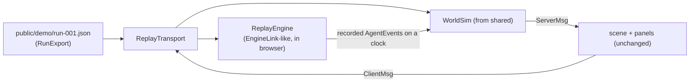

# Design Document: demo-replay

## Overview

Scene and panels do not know which transport is active. ReplayTransport plays the role of the world-server gateway: it routes `ClientMsg` into `WorldSim` and into `ReplayEngine`, and delivers resulting `ServerMsg` to listeners.

## ReplayEngine

- Input: `RunExport { events, artifacts, job }`.
- Builds a schedule: `t_i = events[i].ts - events[0].ts`, then compresses gaps > 10 s to 2 s, then divides by speed.
- Pauses at `approval.requested` until the user resolves it in the mailbox; resumes with the recorded `approval.resolved`.
- The computer panel lists one repo (the recorded one); `start_job` starts the schedule. The goal field is prefilled with the recorded goal and read-only.
- Clock: `performance.now()`-based virtual clock with speed factor; `WorldSim` receives the same virtual clock so walks stay in sync.

## Mode selection

`src/mode.ts`: `const mode = new URLSearchParams(location.search).get("mode") ?? import.meta.env.VITE_MODE ?? "live"`. In demo mode the client never constructs `LiveTransport`.

## Publishing

- `.github/workflows/pages.yml`: checkout, pnpm install, `VITE_MODE=demo pnpm --filter @agentlife/client build -- --base=/<repo-name>/`, upload `packages/client/dist` with `actions/upload-pages-artifact`, deploy with `actions/deploy-pages`.
- The repo name is read from `${{ github.event.repository.name }}`.

## Smoke test

`packages/client/e2e/demo.spec.ts` with Playwright: `vite preview` the demo build, open it, assert banner text, wait for a `[data-agent-state]` DOM attribute (the overlay mirrors agent states into a hidden DOM list for testability and accessibility) to change from `idle`.

## Testing strategy

- Unit: schedule builder (property test: compressed schedule is monotonic, preserves order, and no gap exceeds 10 s / speed), approval pause/resume.
- E2E: smoke test above, run in CI after the Pages build.
