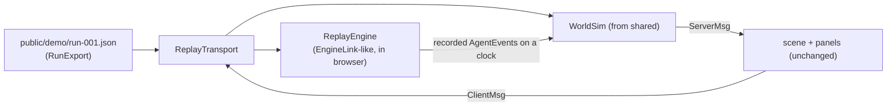

# Design Document: demo-replay

## Overview

Scene and panels do not know which transport is active. ReplayTransport plays the role of the world-server gateway: it routes `ClientMsg` into `WorldSim` and into `ReplayEngine`, and delivers resulting `ServerMsg` to listeners.

## ReplayEngine

- Input: `RunExport { events, artifacts, job }`.
- Builds a schedule: `t_i = events[i].ts - events[0].ts`, then compresses gaps > 10 s to 2 s, then divides by speed.
- Pauses at `approval.requested` until the user resolves it in the mailbox; resumes with the recorded `approval.resolved`.
- The computer panel lists one repo (the recorded one); `start_job` starts the schedule. The goal field is prefilled with the recorded goal and read-only.
- Clock: `performance.now()`-based virtual clock with speed factor; `WorldSim` receives the same virtual clock so walks stay in sync.

## Mode selection

`src/mode.ts`: `const mode = new URLSearchParams(location.search).get("mode") ?? import.meta.env.VITE_MODE ?? "live"`. In demo mode the client never constructs `LiveTransport`.

## Publishing

- `.github/workflows/pages.yml`: checkout, pnpm install, `VITE_MODE=demo pnpm --filter @agentlife/client build -- --base=/<repo-name>/`, upload `packages/client/dist` with `actions/upload-pages-artifact`, deploy with `actions/deploy-pages`.
- The repo name is read from `${{ github.event.repository.name }}`.

## Smoke test

`packages/client/e2e/demo.spec.ts` with Playwright: `vite preview` the demo build, open it, assert banner text, wait for a `[data-agent-state]` DOM attribute (the overlay mirrors agent states into a hidden DOM list for testability and accessibility) to change from `idle`.

## Testing strategy

- Unit: schedule builder (property test: compressed schedule is monotonic, preserves order, and no gap exceeds 10 s / speed), approval pause/resume.
- E2E: smoke test above, run in CI after the Pages build.

## Decisions made while implementing (tasks 1-4)

- Files: `src/mode.ts`; `src/replay/{schedule,engine,transport}.ts`; `src/ui/replay-bar.ts`. The client has no image or audio files (sprites are procedural), so the only static asset routed through `assetUrl()` (`import.meta.env.BASE_URL`) is `demo/run-001.json`.
- The room for the replay is `packages/world-server/rooms/office.json`, imported dynamically in `main.ts` in demo mode only (no copy to keep in sync; the live bundle does not carry it).
- `ReplayEngine` is driven by the host with `advance(dtMs)` (real elapsed time) instead of reading a clock itself, so tests are deterministic. Time on the schedule is "compressed ms at 1x"; speed scales the playhead. At `approval.requested` the playhead stops; `resolveApproval` jumps to the recorded `approval.resolved` and continues from there. Reject: the decision is not honoured (the recorded run was approved); the transport adds an Architect activity line `REPLAY_REJECT_NOTE`.
- The `WorldSim` clock is the wall clock (`Date.now`), not the replay's virtual clock. The client renders walks against `Date.now`, so a virtual clock would desync the user's avatar. Agent walks therefore keep their normal speed at 4x/16x; a new `agent.goto` replaces the walk in progress, so fast speeds look like quick hops, not wrong positions. Speed only scales the event schedule.
- Event `ts` and `agent.work.startedAt` are rebased onto the compressed timeline from the start of the replay, so the board and elapsed times agree with what is on screen. `job_details` is built from the recorded export but only shows artifacts, steps and approvals the replay has reached.
- `ReplayTransport` duplicates the gateway's panel bookkeeping (approvals, reports, activity, work, job view). The gateway lives in world-server and cannot be imported by the client; moving it to `shared` is possible later but was not worth it for the MVP.
- The computer panel shows the recorded goal read-only in replay mode (`PanelHooks.lockedGoal`).
- `models` in the welcome come from `agent.work` events or step `model` fields of the export. `run-001.json` has neither (recorded before job-insight), so tooltips show no model in the demo until the run is re-recorded.
