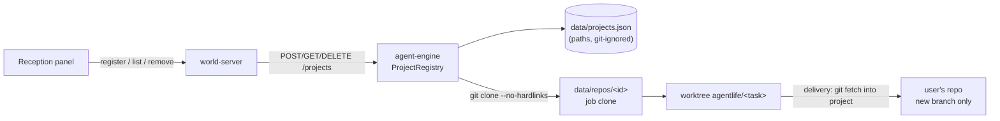

# Design Document: project-registry

## Overview

## Engine modules

- `src/projects/roots.ts`: `allowedRoots()` from `config/hotel.json` (`{ "projectRoots": ["D:\\AgentHotel"] }`) and `AGENTLIFE_PROJECT_ROOTS`; `isInsideRoot(realPath, roots)` using `fs.realpathSync.native`, normalised separators, case-insensitive comparison on win32, and a trailing-separator check so `D:\AgentHotelX` is not inside `D:\AgentHotel`. Creates the default root if it does not exist (empty folder only).
- `src/projects/registry.ts`: `ProjectRegistry` (load/save `data/projects.json` atomically: write temp file + rename), `register(input)`, `list()`, `remove(id)`, `get(id)`. Built-in `haunted-todo` comes from `config/repos.json` as today and is merged into the list, flagged `builtin: true`.
- `src/projects/inspect.ts`: git checks (`rev-parse --is-inside-work-tree`, `rev-parse HEAD`, `ls-files -z` for counts, `cat-file -s` sum or `git ls-files -s` + `du`-equivalent capped read), stack detection, refuses the AGENT LIFE root (`PROJECT_ROOT`).
- Leak scanning: move the scanning core of `scripts/security-scan.ts` (patterns, masking, `scanText`) into `packages/shared/src/leaks.ts`; the script and the engine both use it. The engine scans only tracked files of the project, never history (too slow and not needed: the clone used by agents is `HEAD`).
- `steps/materialise.ts`: for registered projects, `git clone --no-hardlinks --single-branch --branch <current> <path> data/repos/<id>`; keep the existing copy path for the fixture. Post-clone checks: symlinks and reserved agent files as today.
- Test images: `scripts/runner-build.ts` generalised to `buildRunnerImage(projectId, dir)`; tag `agentlife-runner-<id>:<first 12 hex of sha256(package-lock.json)>`; `steps/test.ts` takes the image from the project.
- Agent permissions: extend the deny lists in `agents/agentlife-*.json` (requirement 4.1); `test/agents.test.ts` asserts every listed pattern is denied for all three roles.
- Delivery: `src/projects/deliver.ts` → `git -C <project> fetch --no-tags <clone> refs/heads/agentlife/<task>:refs/heads/agentlife/<task>` after checking `show-ref --verify --quiet refs/heads/agentlife/<task>` is absent. Route `POST /tasks/:id/deliver`. Event `delivery.done`.

## Shared

- `projects.ts`: `ProjectSchema` (public view: `id`, `name`, `stack`, `testCommand`, `builtin`, `registeredAt`), `RegisterProjectBody`, `RegisterProjectResult` (ok, or `needsAcceptance` with masked findings, or error with `code`), `delivery.done` event.
- The existing `Repo` type and `repoId` naming stay for compatibility; the computer panel reads projects.

## World-server and client

- Panel data requests `projects` and actions `register_project`, `remove_project`, `deliver` proxied to the engine.
- `rooms/office.json`: reception desk near the door; furniture catalog entry `reception_desk` with `interaction: "reception"` and hint.
- `ui/reception.ts`: list + form + confirmation with masked findings; `ui/report-viewer.ts`: "Deliver as branch" button and delivered state.

## Security notes

- The only new write outside `data/` is the delivery `git fetch` into the user's repository, limited to creating a new `agentlife/<task>` ref.
- Absolute paths stay inside the engine (requirement 2); errors returned to the client name the rule, not the path.
- The real code is sent to the model provider when agents read it; the Reception form says so ("Agents read this project's code through Kiro; secret files are blocked").

## Decisions made while implementing

Recorded during tasks 1–5 (branch `feat/project-registry`). Where the text above differs, this section wins.

- **Leak scanner location.** The core is `packages/shared/src/leaks.ts` and is imported as `@agentlife/shared/leaks` (a `package.json` subpath export). It is not in the package index because it uses `node:crypto` and the client bundle imports the index. `scripts/security-scan.ts` imports the file by relative path and keeps the repository-specific parts (known secrets from `.env`, allowlist file, `data/` check, git history).
- **What registration scans.** The tracked files of `HEAD` (read with one `git cat-file --batch`), never history. Files over 1 MB, lockfiles, binary assets and anything past 64 MB of total content are checked by name only (a tracked `.env` is still found). Only high and medium findings are shown and block; low ones (home paths) are ignored. `needs_acceptance` lists at most 30 distinct values, each with its first file and a count. Accepted findings are stored as ids (hashes) in `acceptedFindings`, never as values.
- **Test command is not prefilled.** The spec asked for a form field prefilled after detection. Detection needs a second request, so the field is blank with the placeholder "Leave empty for the default (npm test)"; blank means the default of the detected stack. A node project may override it; an `unsupported-tests` project always has an empty command.
- **Ids.** Slug of the name (lower case, a–z, 0–9, `-`, 40 characters); a taken id (including `haunted-todo`) gets `-2`, `-3`, … . Registering the same folder twice (same real path) is refused with `already_registered`.
- **Roots.** `config/hotel.json` plus `AGENTLIFE_PROJECT_ROOTS` (which replaces the file when set). Only absolute paths of the running platform count, so `D:\AgentHotel` is ignored on Linux. The root folder itself is not a project. The engine creates the missing root folders only from `main.ts`, never from `startEngine` (tests). The refusal message for a folder outside the roots names the allowed roots (configuration, not a project path).
- **Checks at job time.** `ProjectRegistry.revalidate` runs again before every clone: the folder must exist and still lie inside a root after links are resolved. `DELETE /projects/:id` answers 409 while a job runs on that project.
- **Job clone.** One clone per project in `data/repos/<id>`, replaced by every job. The clone has no remote and no hooks. Consequence: a newer job on the same project removes the branch of the older one, so delivering the older job fails with `branch_missing`. Deliver before starting the next job.
- **Secret files and `.env.example`.** A `deny` always wins in the agent files, so "`.env*` except `.env.example`" cannot be written. The role agents deny `.env` and `.env.*`, which also hides `.env.example`; the three agents share one list (root and `**/` forms of each pattern), asserted in `test/agents.test.ts`.
- **Test images.** `steps/runner-image.ts` builds `agentlife-runner-<id>:<12 hex of sha256(package-lock.json)>` on first use from the `package.json` and `package-lock.json` of the base commit (read from the clone with `git show`, not from the Developer's worktree). The build has network access (`npm ci --ignore-scripts`); the tests run with `--network none`. The built-in fixture keeps `agentlife-runner:1` and `pnpm --filter @agentlife/agent-engine runner:build`, which now uses the same builder. A first job on a new node project therefore spends the image build time inside the test step's timeout.
- **No tests.** `TestResult.skipped` (with `passed: true`) for `unsupported-tests`; no Docker call at all. The verdict stays `pass`; the report says "PASS (without tests)" and "Not run (no supported test setup)". The QA prompt gets `NOT RUN (…)` as its test status plus a sentence in `prompts/qa.md`.
- **Report base.** `reportStep` adds "Based on commit `<7 hex>` of `<branch>`" for registered projects by reading the clone, so the failure path (which also calls the report step) shows it too. The runner's own fallback report does not.
- **Delivery availability.** The export marks a job `deliverable` when it ran on a registered project, is `report_ready` or `delivered`, its develop step finished and it was not delivered yet; `delivery.done` is folded into `EngineJobView.delivery`. The gateway reads the job details when a `report.ready` event arrives and puts `delivery: { state: "available" | "done" }` on the `report` message; after `deliver` it re-sends the report with `done`, the branch and the commit. The viewer shows the branch and `git log <branch>`. `deliverBranch` refuses with a `ConflictError` (409) for: built-in project, already delivered, missing branch, no change, project unavailable, branch exists. Git runs in the user's repository with `gc.auto=0` and `maintenance.auto=false` for that one command.
- **Protocol additions** (additive, `PROTOCOL_VERSION` unchanged): client `register_project`, `remove_project`, `deliver`; server `projects`, `register_result`; `Report.delivery`; error codes `project_error` and `delivery_failed`; panel and interaction `reception`. `EngineLink` gets optional `listProjects`, `registerProject`, `removeProject`, `deliver`. The scripted (fake) engine lists the fixture and refuses registrations.
- **Fake runtime.** Under `RUNTIME=fake` the engine uses the runtime steps, which never clone or create a branch. Registering and listing work, jobs run, but delivery answers `branch_missing`. Delivery is only exercised with the real pipeline (tests use the real steps over scripted agents).
- **Reception desk.** `reception_desk` (2×1, interaction `reception`) stands at (1,0) on the north wall facing south. The demo build shows the Reception read-only with the fixture listed.
- **Tests.** `packages/agent-engine/vitest.config.ts` points `AGENTLIFE_PROJECTS_FILE` at a file that does not exist so engines started by tests never read the developer's `data/projects.json`, and sets `testTimeout` to 30 s because the git-heavy tests take several seconds on Windows when all packages test in parallel.
