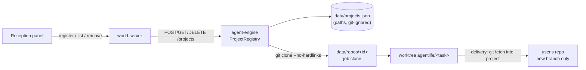

# Design Document: project-registry

## Overview

## Engine modules

- `src/projects/roots.ts`: `allowedRoots()` from `config/hotel.json` (`{ "projectRoots": ["D:\\AgentHotel"] }`) and `AGENTLIFE_PROJECT_ROOTS`; `isInsideRoot(realPath, roots)` using `fs.realpathSync.native`, normalised separators, case-insensitive comparison on win32, and a trailing-separator check so `D:\AgentHotelX` is not inside `D:\AgentHotel`. Creates the default root if it does not exist (empty folder only).
- `src/projects/registry.ts`: `ProjectRegistry` (load/save `data/projects.json` atomically: write temp file + rename), `register(input)`, `list()`, `remove(id)`, `get(id)`. Built-in `haunted-todo` comes from `config/repos.json` as today and is merged into the list, flagged `builtin: true`.
- `src/projects/inspect.ts`: git checks (`rev-parse --is-inside-work-tree`, `rev-parse HEAD`, `ls-files -z` for counts, `cat-file -s` sum or `git ls-files -s` + `du`-equivalent capped read), stack detection, refuses the AGENT LIFE root (`PROJECT_ROOT`).
- Leak scanning: move the scanning core of `scripts/security-scan.ts` (patterns, masking, `scanText`) into `packages/shared/src/leaks.ts`; the script and the engine both use it. The engine scans only tracked files of the project, never history (too slow and not needed: the clone used by agents is `HEAD`).
- `steps/materialise.ts`: for registered projects, `git clone --no-hardlinks --single-branch --branch <current> <path> data/repos/<id>`; keep the existing copy path for the fixture. Post-clone checks: symlinks and reserved agent files as today.
- Test images: `scripts/runner-build.ts` generalised to `buildRunnerImage(projectId, dir)`; tag `agentlife-runner-<id>:<first 12 hex of sha256(package-lock.json)>`; `steps/test.ts` takes the image from the project.
- Agent permissions: extend the deny lists in `agents/agentlife-*.json` (requirement 4.1); `test/agents.test.ts` asserts every listed pattern is denied for all three roles.
- Delivery: `src/projects/deliver.ts` → `git -C <project> fetch --no-tags <clone> refs/heads/agentlife/<task>:refs/heads/agentlife/<task>` after checking `show-ref --verify --quiet refs/heads/agentlife/<task>` is absent. Route `POST /tasks/:id/deliver`. Event `delivery.done`.

## Shared

- `projects.ts`: `ProjectSchema` (public view: `id`, `name`, `stack`, `testCommand`, `builtin`, `registeredAt`), `RegisterProjectBody`, `RegisterProjectResult` (ok, or `needsAcceptance` with masked findings, or error with `code`), `delivery.done` event.
- The existing `Repo` type and `repoId` naming stay for compatibility; the computer panel reads projects.

## World-server and client

- Panel data requests `projects` and actions `register_project`, `remove_project`, `deliver` proxied to the engine.
- `rooms/office.json`: reception desk near the door; furniture catalog entry `reception_desk` with `interaction: "reception"` and hint.
- `ui/reception.ts`: list + form + confirmation with masked findings; `ui/report-viewer.ts`: "Deliver as branch" button and delivered state.

## Security notes

- The only new write outside `data/` is the delivery `git fetch` into the user's repository, limited to creating a new `agentlife/<task>` ref.
- Absolute paths stay inside the engine (requirement 2); errors returned to the client name the rule, not the path.
- The real code is sent to the model provider when agents read it; the Reception form says so ("Agents read this project's code through Kiro; secret files are blocked").
