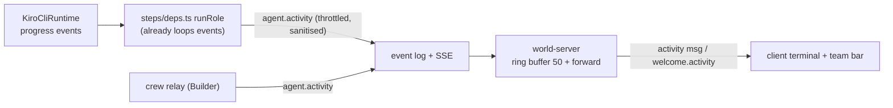

# Design Document: room-ux

## Data path for activity

- `shared/src/events.ts`: add `agent.activity { agentId, text }`.
- `shared/src/sanitize.ts`: move `sanitize` from `scripts/crew-map.ts` into shared so engine, runner and tests use one implementation; `scripts/crew-map.ts` re-exports it.
- `steps/deps.ts` `runRole`: on `ev.kind === "progress"`, emit `agent.activity` for the role through the store's `appendEvent`, throttled per agent (1/s, drop extras), text `sanitize(ev.text)`.
- Crew relay: activity crew events also emit `agent.activity` for `builder` (in addition to the throttled `agent.say`).
- JobRunner: emit `agent.activity` lines for state changes ("Plan ready: 3 tasks"), approval resolved ("Approved task 1"), test result ("Tests passed 11/11" parsed from Vitest's `Tests  N passed` line when present, else exit code).
- Protocol: server message `activity { line: { ts, agentId, text } }`; `welcome.activity?: ActivityLine[]` (max 50).
- World-server gateway: ring buffer of 50 lines fed by `agent.activity` events; forward each as `activity`.

## Client components (plain DOM + CSS, palette colours)

- `ui/team-bar.ts`: rows from agent state (existing `agent_state` messages) + models (`welcome.models`) + last activity; elapsed timer updated once per second; click → `worldView.focusAgent(id)` (pan camera, show tooltip 2 s).
- `ui/stepper.ts`: pure `stepperFor(jobView)` → steps with status; renders at top centre; "Your turn" step opens the mailbox.
- `ui/toast.ts`: your-turn toast driven by `mailbox-state.ts` (pending count); updates `document.title`.
- `ui/terminal.ts`: ring buffer 300, filter by agent, auto-scroll unless scrolled up, collapse/resize handle; seeded from `welcome.activity`.
- `ui/theme.ts`: CSS custom properties for font size (`--al-font`), A−/A+ control in `hud.ts`, persisted.
- Report diff colouring in `ui/markdown.ts`: fenced blocks tagged `diff` get per-line classes `+`/`-` (built with DOM nodes, never `innerHTML`).
- Room labels: name tags and badges use `--al-font`-independent canvas text at ≥ 11 px with a 2 px dark stroke.

Layout: team bar left (220 px, collapsible to icons), terminal bottom (resizable), stepper and toast top centre, HUD top right. Panels open centred above the terminal.

## Testing strategy

See requirement 6. Manual check: run a real job and confirm the toast, stepper, team bar and terminal all move together.
