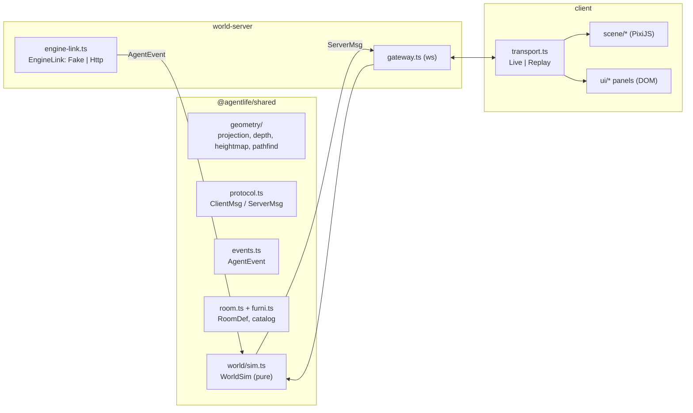

# Design Document: world-room

## Overview

The world is server-authoritative in live mode. To make replay mode possible without a server, all world logic is a **pure world simulation in `@agentlife/shared`**: it takes inputs (user intents, agent events, clock) and produces outputs (server messages). The world-server is a thin WebSocket wrapper around it; in replay mode the browser runs the same simulation locally.



## Coordinates and geometry (`shared/src/geometry/`)

- Tile (x, y), height z in "height units" (1 unit = 16 px).
- `tileToScreen({x,y,z}) = { sx: (x - y) * 32, sy: (x + y) * 16 - z * 16 }` at zoom 1 (tile 64×32).
- `screenToTile` inverts for z = 0 and floors to the containing tile.
- Heightmap: string rows, `x` = void, `0`–`9` = height. `parseHeightmap` returns `{ w, l, height(x,y) | null }`.
- Depth key for sorting: `depth = (x + y) * 1000 + z * 10 + layer`, where multi-tile furniture uses its **front-most** tile (`x + w - 1`, `y + l - 1`) and avatars use their current (interpolated, rounded up) tile. Layers: floor 0, furni 1, avatar 2, overlay 3. Property test: for any two non-overlapping footprints where A is entirely behind B, depth(A) < depth(B).
- Pathfinding: A* on 8-neighbours, Chebyshev heuristic, cost 1 orthogonal / 1.4 diagonal, no corner cutting, max height step 1 unit. Pure function `findPath(grid, from, to): Tile[] | null`.

Reference only: FlaccidNoise/jt-habbo-hotel `packages/shared/src/{projection,depth,heightmap}.ts` (MIT). Write our own; if any code is copied, follow security.md (keep notice, list in ASSETS.md).

## Data model (`shared/src/room.ts`, `shared/src/furni.ts`)

```ts
FurniDef   { id, name, w, l, height, walkable, interaction?: "computer"|"mailbox"|"board", draw: DrawRecipeId }
PlacedFurni{ itemId, defId, x, y, dir: 0|2|4|6 }          // dir 2/6 swap w and l
Anchor     { name: AnchorName, x, y, dir }                // AnchorName = "desk"|"board"|"computer"|"mailbox"|"door"|"home_architect"|"home_developer"|"home_qa"
RoomDef    { id, name, heightmap: string[], door: Anchor, anchors: Anchor[], furni: PlacedFurni[] }
```

Each interactive item has a **use tile** = the tile in front of its footprint according to `dir`; validation checks it is walkable.

Agent desks: the `desk` anchor is resolved per agent (`desk` + agent role → that agent's desk). Implement as `resolveAnchor(room, anchor, agentId)`.

The room lives in `packages/world-server/rooms/office.json` and is also imported by the client for replay mode.

## Protocol (`shared/src/protocol.ts`)

Client → server:
- `hello { protocol }`
- `move { x, y }`
- `use { itemId }`
- `start_job { repoId, goal }`
- `approve { approvalId, decision: "approve"|"reject", note? }`

Server → client:
- `welcome { protocol, room, you, avatars[], agents[] }`
- `walk { id, path: Tile[], msPerTile, startedAt }`
- `face { id, dir }`
- `agent_state { agentId, state, text? }`
- `say { id, text }`
- `open_panel { panel: "computer"|"mailbox"|"board", data }`
- `repos { repos[] }`, `job_update { job }`, `approval { approval }`, `report { report }`
- `error { code, message }` with codes `bad_message | no_path | rate_limited | busy | engine_unavailable`

Avatar ids: user = positive integer; agents = `"architect" | "developer" | "qa"` (string ids, never collide).

## Agent events (`shared/src/events.ts`)

Defined here because the fake engine needs them; agent-engine reuses the same schemas.

```ts
AgentEvent = { seq, ts, taskId, agentId?, type, ...payload }
types: task.created | task.state_changed | task.failed | task.completed
       agent.state_changed {state, text?} | agent.goto {anchor} | agent.say {text}
       artifact.created {kind, artifactId, title}
       approval.requested {approvalId, kind, summary, options?} | approval.resolved {approvalId, decision}
       report.ready {reportId, title, markdown}
```

## World simulation (`shared/src/world/sim.ts`)

```ts
class WorldSim {
  constructor(room: RoomDef, clock: () => number)
  join(): { you: number; welcome: ServerMsg }        // single user in MVP
  handleIntent(userId, msg: ClientMsg): ServerMsg[]  // move, use
  handleAgentEvent(ev: AgentEvent): ServerMsg[]      // goto → walk; state → agent_state; say → say
  snapshot(): WelcomeMsg
}
```

No I/O, no timers: walking state is derived from `startedAt + index * msPerTile` and the clock. This makes it deterministic and testable, and lets the replay transport reuse it.

Implemented addition (client): a horizontal screen mirror swaps dx and dy, so the mirrored directions are 0↔6, 1↔5, 2↔4 (not 5,6,7→3,2,1 numerically). Drawn views are 3, 4, 5, 6, 7; directions 0, 1, 2 are mirrors (`viewFor` in `scene/figure.ts`). Still 5 drawn and 3 mirrored.

Implemented addition: deferred messages (the `face` and `open_panel` that follow a walk) are collected by the host with `dueMessages()`; `nextDeferredAt()` tells it when to wake. A new walk by the same avatar cancels its pending deferred messages. Unreachable `agent.goto` targets are ignored silently; unreachable user `move`/`use` return `no_path`.

`use` on an interactive item: the sim returns `walk` to the use tile plus a deferred `open_panel` that the gateway (or replay transport) sends when the walk ends. Panel data (repos, approvals, reports, timeline) comes from the engine link, not from the sim.

## World-server (`packages/world-server/src/`)

- `main.ts`: load + validate room, create `WorldSim`, create `EngineLink` from `ENGINE` env (`fake` default), start gateway on `PORT` (default 8787), bind `127.0.0.1` by default.
- `gateway.ts`: `ws` server; validates with zod; 16 KB `maxPayload`; token bucket 20 msg/s; one user session in MVP (a second connection replaces the first).
- `engine-link.ts`:
  ```ts
  interface EngineLink {
    listRepos(): Promise<Repo[]>
    startJob(repoId, goal): Promise<{ taskId }>
    resolveApproval(approvalId, decision, note?): Promise<void>
    getJob(taskId): Promise<JobView>
    events(): AsyncIterable<AgentEvent>
  }
  ```
- `fake-engine.ts`: scripted scenario with timed events (walk to board, think, `approval.requested`, wait, develop at desk, QA walks to developer, test, `report.ready`). Uses a fake repo `haunted-todo`.

## Client (`packages/client/src/`)

- `transport.ts`: `interface Transport { send(msg); onMessage(cb) }`; `LiveTransport` over WebSocket to `VITE_WORLD_URL` (default `ws://127.0.0.1:8787`). Replay transport comes in the demo-replay spec.
- `scene/textures.ts`: **procedural art**. Every furniture def has a draw recipe that builds a PixiJS `Graphics` (isometric boxes, cylinders, flat panels) and is converted once to a texture with `renderer.generateTexture`. Avatars: body made of simple shapes (head, torso, legs), 8 logical directions; directions 0–4 are drawn and 5, 6, 7 are horizontal mirrors of 3, 2, 1; 2-frame walk bob. A `SpriteProvider` interface isolates this so real spritesheets can replace it later.
- `scene/room-view.ts`, `scene/furni-view.ts`, `scene/avatar-view.ts`, `scene/overlay.ts` (name tags, badges, bubbles).
- `ui/panels.ts`, `ui/computer.ts`, `ui/mailbox.ts`, `ui/board.ts`; `ui/markdown.ts` renders a safe subset (headings, lists, code, bold) by building DOM nodes, never `innerHTML` with untrusted text.
- `palette.ts`: all colours.

## Error handling

- WebSocket drop: client shows "Reconnecting…" and retries with backoff (1 s, 2 s, 5 s, max 10 s); on reconnect it receives a fresh `welcome`.
- Engine link failure: world-server sends `error engine_unavailable`; computer panel shows the message.

## Testing strategy

- `shared`: unit + fast-check property tests for projection round-trip, depth ordering, heightmap parsing, pathfinding properties, room validation, and WorldSim (e.g. after any sequence of valid intents, every avatar stands on a walkable tile).
- `world-server`: gateway tests with a real `ws` client on an ephemeral port (validation, rate limit, welcome).
- `client`: unit tests for pure helpers (markdown renderer escapes HTML, panel state). Rendering itself is checked manually with `pnpm --filter @agentlife/client dev`.
