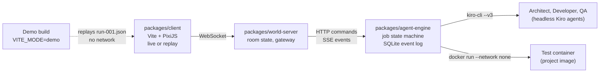

# AGENT LIFE

AGENT LIFE is an isometric virtual hotel whose residents are real AI agents doing verifiable software work. Register a git project, describe a change, and watch an Architect, a Developer and a QA agent plan it, write it in an isolated worktree, run the tests in Docker, and deliver the result as a branch. The report arrives in the mailbox.

Kiroween 2026 entry — category: **Resurrection**.

## Demo

**Live demo:** https://adan291.github.io/agentlife-/

The demo runs in the browser with no backend. It replays a recorded real run: an Architect plan, a Developer diff, the test log and a QA review. Approve the plan in the mailbox to continue. Speed buttons: 1×, 4×, 16×.

## What the hotel has

- **Lobby** with a Reception (register projects under `D:\AgentHotel`), a shop counter, a construction board (TASKMAP live from the conductor) and an elevator with floor status.
- **A floor per project.** Each team has an Architect desk, a Developer desk and a QA desk, plus up to six standing spots for extra members (reviewer, researcher, intern). The stepper, the team bar, the terminal and the mailbox scope to the floor.
- **Job kinds:** change (default), review a branch, write tests, document, audit dependencies, plus a night-shift scheduler with pre-approved scoped changes and a morning summary.
- **HR office.** Hire, rename, change model and fire from a catalogue of 11 templates. Import external agent personas from an allowlisted URL (reviewed before they can be hired). An Ollama intern works for free.
- **Pipeline editor.** Choose the roles and the optional research and second-review steps per project.
- **Library.** After a job the librarian (Ollama first, then Kiro) proposes notes; accepted ones go into the next job's prompts.
- **List view and command palette.** `L` and `Ctrl+K` let you act on any floor without walking to the elevator.
- **Housing and game layer.**
  - *Ecto* is earned only from verified work (a passed job, a delivered branch, a note kept). Spend it in the shop on furniture and outfits.
  - *Outfits* (hat, top, accessory) for every ghost and the user avatar, bought or unlocked by badges, worn from the HR desk or the Profile.
  - *XP, levels and badges* from real stats (jobs, pass rate, average step time). Badges: First delivery, Ten deliveries, Night owl, Librarian, Clean streak and more.
  - *Daily quests* from real work: approve a plan, deliver a branch, accept a note.
  - *Edit room.* Move and rotate furniture on any floor; the server checks every move for reachability.
  - *Wisps* to catch while jobs run, emotes (keys 1–4) and a coffee machine for tired agents.
- **Bug sack.** Every unhandled error (browser, PixiJS, world-server, agent-engine, Docker, conductor) is grouped and kept in `data/bugs.jsonl`. F8 or Menu → "Report a bug" saves a note with a screenshot. The panel has Game and Code tabs, Fixed / Ignored status and "Copy for Kiro".

## What happens in a job

1. **Computer**: choose the project and write a goal.
2. **Architect** reads the repository and proposes a plan.
3. **You** approve or reject the plan in the mailbox. Nothing is written before approval.
4. **Developer** edits files in its own git worktree. No shell, no network.
5. The **engine** validates the diff, then runs the project's tests in a Docker container with `--network none`, CPU, memory and time limits, and a non-root user.
6. **QA** reviews the diff and the test log.
7. The **report** arrives in the mailbox. Press "Deliver as branch" to get a new branch in your repository. Your working copy is never touched.

## Architecture



| Path | What |
|---|---|
| `packages/shared` | Protocol and event schemas (zod), geometry, game rules |
| `packages/client` | Vite + PixiJS front end, live and replay transports |
| `packages/world-server` | Room state, WebSocket gateway, economy, progress, bugs |
| `packages/agent-engine` | Job state machine, `kiro-cli` runtime, diff validation, Docker runner |
| `config/` | Allowed project roots, catalogue, economy, outfits, badges, quests, pipelines |
| `docs/` | Design decisions and the status log (mostly in Spanish) |
| `.kiro/` | Kiro steering, specs, hooks and custom agents |

The client talks only to the world-server. The world-server never calls a model. Model providers sit behind the `AgentRuntime` interface; switching provider requires no change to the client or the world-server.

## Safety model

- Projects come from `D:\AgentHotel` only (configurable in `config/hotel.json`). No arbitrary URLs.
- Architect and QA are read-only. Developer writes only inside its task worktree.
- Agents never push, merge, open pull requests, or touch `.git`, CI files or env files. Kiro custom agents enforce this with `permissions.rules`.
- The engine validates every diff (paths, no binaries, size limit) before any other step uses it.
- Tests run only in Docker with `--network none`, a read-only source mount, a non-root user, and CPU, memory and time limits.
- Repository contents and model output are untrusted data, never instructions to the engine.
- Secrets (`KIRO_API_KEY`, tokens) come from environment variables or a git-ignored `.env`. Never logged or sent to the client.
- Publishing gate: `pnpm security:scan` must report no high or medium findings before anything leaves the machine. A Kiro hook and a git pre-push hook enforce it.

## Quick start

One command starts everything (engine, world-server, client) and opens the hotel in the browser:

```bash
pnpm install          # first time only
pnpm hotel            # or double-click "Start AGENT LIFE.cmd" on Windows
```

`pnpm hotel` checks what is there and picks the mode by itself:

- **Real agents** when an AI and Docker are there: Kiro when `KIRO_API_KEY` is set (in `.env`, see [.env.example](.env.example)), else Ollama when it is running. On Windows it starts Docker Desktop if it is installed and not running.
- **Scripted agents** otherwise, and it says why. They need no credits and no Docker, so the whole hotel works on any machine.
- **Ollama** is used for the ambient phrases and the Library intern when it answers on `127.0.0.1:11434` (optional).

| Command | What it does |
|---|---|
| `pnpm hotel` | real agents if possible, else scripted |
| `pnpm hotel --ai ollama --model qwen3.5:4b` | the three roles run on that AI and model (see AI providers) |
| `pnpm hotel --fake` | scripted agents (no credits, no Docker) |
| `pnpm hotel --real` | real agents even if a check fails |
| `pnpm hotel --restart` | stop a hotel already running on ports 8787, 8788, 5173 and start again |
| `pnpm hotel --no-open` | do not open the browser |

The logs of the three processes appear in the same window with a prefix (`[engine]`, `[world]`, `[client]`). Ctrl+C, or closing the window, stops all of them. Only the engine receives the Kiro key; it is never printed.

### AI providers

The agents run on Kiro by default, and on any AI that speaks the OpenAI chat format with tool calls: Ollama and LM Studio on your computer, or Groq, xAI Grok, OpenAI and OpenRouter in the cloud. The list is `packages/agent-engine/config/providers.json`; another compatible API is one more entry.

- **For the whole team, one run:** `pnpm hotel --ai <provider> [--model <model>]`. Without `--model` the provider's first model is used (for Ollama, `LLM_MODEL`).
- **Per role, always:** `{ "provider": "ollama", "model": "qwen3.5:4b" }` instead of `{ "runtime": "kiro-cli", ... }` in `packages/agent-engine/config/agents.json`.
- **Per hired member:** pick the AI and the model at the HR desk. Several AIs can work on the same job, and a second review counts as "another model" when the provider differs.
- **Cloud keys** go in `.env` (`GROQ_API_KEY`, `XAI_API_KEY`, `OPENAI_API_KEY`, `OPENROUTER_API_KEY`). Only the engine gets them; an AI without its key is shown as not available. A cloud AI receives the files its agent reads, and the HR desk says so when you choose it.
- **Same rules on every AI:** outside Kiro the model gets only `list_files`, `read_file`, `search` and, for the Developer, `write_file`. The engine runs them inside the job's folder with the same deny list of secret files. There is no shell and no network, and the diff check, the Docker tests and your plan approval stay the same.

For real jobs on your own code, create `D:\AgentHotel` (the allowed projects folder, see `config/hotel.json`), copy a small git project there and register it at the Reception desk in the lobby.

## Run live mode by hand

Requirements: Node.js 22+, pnpm 11+, Docker Desktop, a `KIRO_API_KEY` from a Kiro plan that allows headless use, and Ollama (optional, for the ambient phrases and the library intern).

```bash
pnpm install
pnpm check                                           # typecheck and tests
pnpm --filter @agentlife/agent-engine runner:build   # build the test image (needed for real jobs)
```

Create `D:\AgentHotel` and copy a small git project there. Then open three terminals:

```powershell
# 1. Engine
cd packages\agent-engine
$env:KIRO_API_KEY = "..."          # or put it in .env
$env:LLM_BASE_URL = "http://127.0.0.1:11434/v1"   # Ollama (optional)
$env:LLM_MODEL    = "qwen3.5:4b"                   # Ollama model (optional)
node --experimental-strip-types --no-warnings src/main.ts   # port 8788

# 2. World-server (start after the engine)
$env:ENGINE = "http"
node --experimental-strip-types --no-warnings packages/world-server/src/main.ts   # port 8787

# 3. Client
pnpm --filter @agentlife/client dev    # open http://localhost:5173/
```

Use `$env:RUNTIME='fake'` for the engine to run with scripted agents that need no credentials.

To play the recorded run without the engine, open `http://localhost:5173/?mode=demo` after starting only the client.

## Build the demo

```bash
VITE_MODE=demo pnpm --filter @agentlife/client build --base=/agentlife-/
pnpm --filter @agentlife/client check:demo-build   # fails if the build references a live endpoint
```

The `pages.yml` workflow builds and deploys to GitHub Pages on every push to `main`.

## Tests

```bash
pnpm check                                          # typecheck and unit tests (all packages)
$env:E2E_CHANNEL='msedge'                           # Windows: use installed Edge
pnpm --filter @agentlife/client e2e                 # browser suite (Playwright, scripted engine)
pnpm --filter @agentlife/client e2e:update-visuals  # rewrite screenshot baselines for this platform
pnpm --filter @agentlife/client e2e:demo            # smoke test of the demo build
pnpm run bugs                                       # list open bug groups from data/bugs.jsonl
```

The browser suite (164 tests) has user journeys through the whole hotel, layout and interface rules at 360×640, 800×600 and 1366×768, and 127 screenshot comparisons. It starts its own servers and writes only scratch files; it never touches the hotel's `data/`.

Stop any server on ports 8795–8798 or 5196–5199 before a run. On Linux run `pnpm --filter @agentlife/client exec playwright install chromium` once.

Screenshot baselines live in `packages/client/e2e/__visuals__/<platform>/`. A platform without a folder skips comparisons. After `e2e:update-visuals` review the PNG diff in the commit. A failed run keeps its report at `packages/client/playwright-report/`.

The conductor (`pnpm conduct`) runs the browser suite and `e2e:demo` after every spec merge. CI runs the suite on Linux and Windows on every push, without screenshot comparisons, and keeps the report on failure.

## Assets and attribution

Only CC0 or MIT assets and code are used. Every item is listed in [ASSETS.md](ASSETS.md) with its source and licence. No Habbo (Sulake) graphics, sounds, names, code or trade dress are used or copied.

## License

MIT. See [LICENSE](LICENSE).
