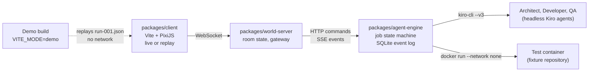

# AGENT LIFE

AGENT LIFE is an isometric virtual hotel whose residents are real AI agents. Click the computer, describe a change, and watch an Architect, a Developer and a QA agent plan it, write it in an isolated worktree, run the tests in Docker, and review the result. The report arrives in the mailbox.

Kiroween 2026 entry, category: **Resurrection**.

## Demo

**Live demo:** https://adan291.github.io/agentlife-/

The demo runs in the browser with no backend. It replays a real run that was recorded from the agent engine (`packages/client/public/demo/run-001.json`): an Architect plan, a Developer diff, the test log and a QA review. A banner marks it as a replay, and the speed buttons offer 1×, 4× and 16×. Approve the plan in the mailbox to continue the replay.

## What happens in a job

1. **Computer**: choose the repository (from an allowlist) and write a goal.
2. **Architect** (read-only) reads the repository and proposes a plan with tasks.
3. **You** approve or reject the plan in the mailbox. Nothing changes before approval.
4. **Developer** edits files inside its own git worktree. It has no shell and no network tools.
5. The **engine** checks the diff (paths inside the worktree, no binaries, size limit), then runs the target repository's tests in a Docker container with no network and CPU, memory and time limits.
6. **QA** (read-only) reviews the diff and the test log.
7. The **report** is delivered to the mailbox. The **board** shows the job timeline.

The model never runs the tests. The engine decides pass or fail from the container exit code.

## Architecture



| Path | What |
|---|---|
| `packages/shared` | Protocol and event schemas (zod), isometric geometry |
| `packages/client` | Vite + PixiJS front end, live transport and replay transport |
| `packages/world-server` | Room state, WebSocket gateway, forwards commands to the engine |
| `packages/agent-engine` | Job state machine, `kiro-cli` runtime, diff checks, Docker test runner |
| `fixtures/repos/haunted-todo` | The allowlisted test repository used by the jobs |
| `docs/` | Design decisions and the status log (mostly in Spanish) |
| `.kiro/` | Kiro steering, specs, hooks and custom agents |

The client talks only to the world-server. The world-server never calls a model. The engine speaks semantic anchors (`desk`, `board`, `computer`, `mailbox`) and knows nothing about tiles or sprites. Model providers sit behind the `AgentRuntime` interface.

## Safety model

- Repositories come from an allowlist. No arbitrary URLs.
- Architect and QA are read-only. Developer writes only inside its task worktree.
- Agents never push, merge, open pull requests, or touch `.git`, CI files or env files. Kiro custom agents enforce this with `permissions.rules`.
- The engine validates every diff before any other step uses it.
- Tests run only in Docker with `--network none`, read-only source mounts, a non-root user, and CPU, memory and time limits.
- Repository contents and model output are untrusted data. They never become instructions to the engine.
- Secrets (`KIRO_API_KEY`, tokens) come from environment variables or a git-ignored `.env`. They are never logged or sent to the client.
- The publishing gate: `pnpm security:scan` must report no high or medium findings before anything leaves the machine. A Kiro hook and a git pre-push hook enforce it.

## Run live mode

Requirements: Node.js 22+, pnpm, and for real jobs Docker Desktop and a `KIRO_API_KEY` with a Kiro plan that allows headless use.

```bash
pnpm install
pnpm check                                   # typecheck and tests
pnpm --filter @agentlife/agent-engine runner:build   # test image, needed for real jobs
```

Open three terminals from the repository root:

```bash
# 1. Engine. Use RUNTIME=fake for scripted agents that need no Kiro credentials.
pnpm --filter @agentlife/agent-engine start

# 2. World server (PowerShell: $env:ENGINE='http')
ENGINE=http pnpm --filter @agentlife/world-server start

# 3. Client, then open http://localhost:5173/
pnpm --filter @agentlife/client dev
```

To play the recorded run without the engine, open http://localhost:5173/?mode=demo after starting only the client.

## Build the demo

```bash
VITE_MODE=demo pnpm --filter @agentlife/client build --base=/agentlife-/
pnpm --filter @agentlife/client check:demo-build   # fails if the build references a live endpoint
```

The `pages.yml` workflow runs the checks, the Playwright smoke test (`pnpm --filter @agentlife/client e2e:demo`) and deploys the build to GitHub Pages on every push to `main`.

## Assets and attribution

Only CC0 or MIT assets and code are used. Every item is listed in [ASSETS.md](ASSETS.md) with its source and licence. No Habbo (Sulake) graphics, sounds, names, code or trade dress are used or copied.

## License

MIT. See [LICENSE](LICENSE).
