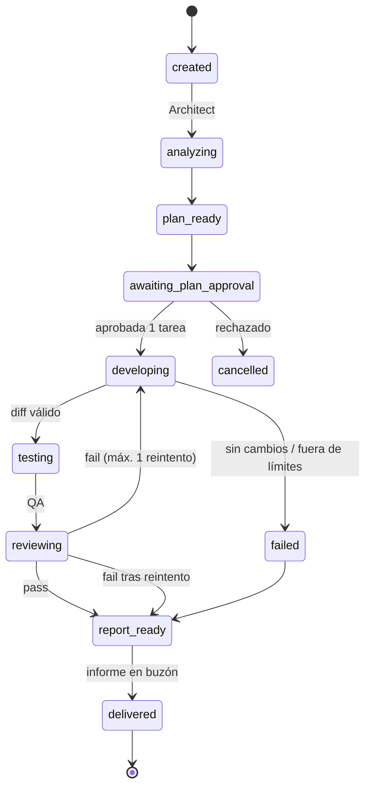

# AGENT LIFE — Diseño del sistema de agentes

## Decisión

El Agent Engine es una **máquina de estados en TypeScript** que ejecuta un pipeline fijo con los pasos Architect, aprobación, Developer, pruebas, QA e informe. Cada rol se ejecuta a través de un **runtime intercambiable**.

En el MVP, los tres roles usan `kiro-cli` en modo headless, con un agente personalizado por rol y sus propios permisos. Ollama se integra con el mismo contrato para Architect en local y para el diálogo de ambiente.

No se usa ningún framework de agentes.

## Dos niveles que no hay que mezclar

| Nivel | Qué es | Herramientas |
|---|---|---|
| **Agentes del producto** | Los habitantes de AGENT LIFE que trabajan sobre el repositorio de prueba | Agent Engine + `kiro-cli` / Ollama / Codex como runtimes |
| **Equipo de desarrollo** | Quien construye AGENT LIFE | Kiro IDE (specs, hooks, steering), Codex (revisión), Kiro Crew + Discord (avisos), tú (producto y aprobaciones) |

## Roles del MVP

| Rol | Entrada | Salida (artefacto) | Permisos | Runtime del MVP |
|---|---|---|---|---|
| Architect | Snapshot del repo (solo lectura) y objetivo del usuario | `plan.json`: de 1 a 5 tareas con título, motivo, ficheros afectados, criterio de aceptación y riesgo | Leer ficheros del snapshot. Sin escritura, sin shell, sin red. | `kiro-cli` con el agente `agentlife-architect` |
| Developer | Una tarea aprobada y un worktree limpio | Cambios en el worktree. El motor genera `diff.patch`. | Escribir solo dentro del worktree. Shell denegada. Sin `git push`. | `kiro-cli` con el agente `agentlife-developer` |
| Test runner (no es un LLM) | El worktree | `test_log.txt` y el código de salida | Docker con `--network none`, CPU, memoria y tiempo limitados | El propio motor |
| QA | La tarea, el diff y el log de pruebas | `review.json`: `pass` o `fail`, observaciones y riesgo | Solo lectura | `kiro-cli` con el agente `agentlife-qa`. Codex como alternativa post-MVP. |
| Coordinator (no es un LLM en el MVP) | Eventos | `report.md` en el buzón | Ninguno | El propio motor, con plantilla |

Las pruebas no las ejecuta el LLM: el resultado tiene que ser verificable y no depender de lo que el agente diga que pasó.

## Máquina de estados de un trabajo



Reglas:

- **Un trabajo activo cada vez en el MVP.** Evita condiciones de carrera en la habitación y en los créditos.
- **Tiempos máximos por paso:** Architect 5 min, Developer 10 min, pruebas 5 min y QA 5 min, todos configurables. Si se supera el tiempo, se mata el proceso y el paso pasa a `failed`.
- **Cada transición emite eventos.** El estado se reconstruye leyendo los eventos.

## Interfaz de runtime

```ts
interface AgentRuntime {
  readonly id: "kiro-cli" | "llm" | "codex";
  run(input: {
    role: Role;
    prompt: string;            // construido por el motor a partir de la plantilla del rol
    cwd: string;               // snapshot o worktree
    timeoutMs: number;
    signal: AbortSignal;
  }): AsyncIterable<RuntimeEvent>;   // progreso → agent.say / agent.state_changed
}
```

El rol nunca decide su runtime. Lo decide la configuración (`agents.yaml`), así que cambiar de modelo o de proveedor no toca ni el cliente ni el World Server.

### KiroCliRuntime [Verificado en la documentación de kiro.dev]

- **Invocación:** `kiro-cli chat --v3 --no-interactive --agent <rol> --output-format stream-json "<prompt>"`, con `cwd` = worktree.
- **Autenticación:** con `KIRO_API_KEY`, que requiere un plan Pro o superior.
- **Progreso:** `stream-json` emite JSON Lines y se traduce a eventos de progreso.
- **Códigos de salida:** documentados (por ejemplo, 4 si el agente no existe).
- **Permisos:** cada agente se define con `tools` y `permissions.rules` (capability `fs_write`/`shell`/`web_fetch`, `match` con globs y `effect` `allow`/`deny`). Un `deny` gana siempre.
- **Alternativa persistente:** `kiro-cli acp` (JSON-RPC por stdio). Se evalúa solo si el arranque por ejecución resulta demasiado lento.

Ejemplo orientativo de agente Developer (validar la sintaxis exacta contra la [referencia de configuración](https://kiro.dev/docs/custom-agents/configuration-reference.md) [Por verificar]):

```json
{
  "name": "agentlife-developer",
  "description": "Implements one approved task inside the current worktree",
  "tools": ["read", "write"],
  "permissions": {
    "rules": [
      { "capability": "fs_write", "match": ["./**"], "effect": "allow" },
      { "capability": "fs_write", "match": [".git/**", "**/.env*"], "effect": "deny" },
      { "capability": "shell", "match": ["*"], "effect": "deny" },
      { "capability": "web_fetch", "match": ["*"], "effect": "deny" }
    ]
  }
}
```

**Defensa en profundidad:** no se confía solo en la configuración del agente. Al terminar, el motor comprueba el diff:

- solo hay rutas dentro del worktree;
- no hay ficheros binarios;
- no se tocan `package.json` scripts, CI ni `.git`;
- el tamaño máximo es N líneas.

Si alguna comprobación falla, se rechaza.

### LlmRuntime (Ollama y otros compatibles con OpenAI)

- Hace `POST /v1/chat/completions` contra `OLLAMA_URL` u otra base URL.
- Para el Architect local, el motor ofrece herramientas propias de solo lectura confinadas al snapshot: `list_files`, `read_file` y `grep`, con límite de bytes.
- **Por verificar:** si `qwen3.5:4b` o `llama3.1` (8B) hacen tool calling fiable con la API de Ollama, y con qué calidad de plan. Tu hardware (16 GB de VRAM) permite probar modelos de 8 a 14B cuantizados. `glm-4.7-flash` (17,7 GB) no cabe entero en la VRAM y será lento. [Supuesto]
- **Uso garantizado en el MVP:** frases de ambiente (`agent.say`) mientras trabajan, generadas a partir del evento actual. Si Ollama no está, se usan frases predefinidas. Es el mismo patrón que usa The Grand.

### CodexRuntime (post-MVP)

- `codex exec` es el modo no interactivo de Codex CLI ([documentación de OpenAI](https://developers.openai.com/codex/guides/autofix-ci)).
- Sería un segundo QA o Reviewer independiente de Kiro, útil para la narrativa de "revisión cruzada".
- **Por verificar:** que Codex CLI esté instalado y autenticado. Ahora mismo no está en el PATH.

## Memoria y contexto

| Tipo | MVP | Después |
|---|---|---|
| Contexto de tarea | Los artefactos del trabajo (plan, diff, log, review) se pasan explícitamente en el prompt del siguiente rol. Es el patrón *blackboard*: los agentes se comunican por artefactos, no por chat libre. | Igual |
| Memoria de proyecto | `AGENTS.md` o el steering del repositorio objetivo, si existe | Resúmenes por repositorio guardados tras cada trabajo |
| Biblioteca (RAG) | Fuera del MVP | Embeddings con `nomic-embed-text` (ya instalado) y `sqlite-vec` |

La comunicación entre agentes que se ve en el mundo (bocadillos, caminar hacia otro agente) es una representación de las transiciones del pipeline. No es una conversación real que pueda desviar el flujo, y eso mantiene el sistema predecible.

## Aprobación humana

| Acción | Política en el MVP |
|---|---|
| Leer un repositorio de la lista permitida | Automática |
| Ejecutar el plan de Architect (empezar a escribir código) | **Requiere aprobación** en el buzón |
| Ejecutar las pruebas del repositorio en Docker | Automática solo para repositorios de la lista permitida. Para cualquier otro repositorio, no está disponible. |
| Fusionar, hacer push o abrir un PR | No disponible en el MVP. El resultado es un diff y una rama local. |
| Repositorios arbitrarios por URL | No disponible en el MVP |

## Observabilidad

- **Tabla `events`** (append-only): `seq`, `ts`, `task_id`, `agent_id`, `type`, `payload_json`. Es la fuente de verdad, sirve para la reconexión SSE y genera el modo demo.
- **Logs estructurados** en JSON por proceso.
- **Salida cruda de cada runtime** guardada en `data/runs/<task>/<step>.jsonl`.
- **Métricas por paso:** duración, código de salida y, si `stream-json` lo expone, créditos o tokens [Por verificar].
- **Panel "Tablón" en el cliente:** línea temporal del trabajo.

## Repositorio de prueba

Repositorio propio y pequeño, creado durante el hackathon (por ejemplo, `agentlife-sample-todo`): un módulo TypeScript con 3 o 4 funciones, pruebas en Vitest y 2 o 3 issues sembrados a propósito, como un bug, una función sin pruebas y una validación ausente.

- Hace la demo repetible.
- No necesita red durante las pruebas: `node_modules` se instala en la imagen Docker.
- Evita ejecutar código de terceros.
