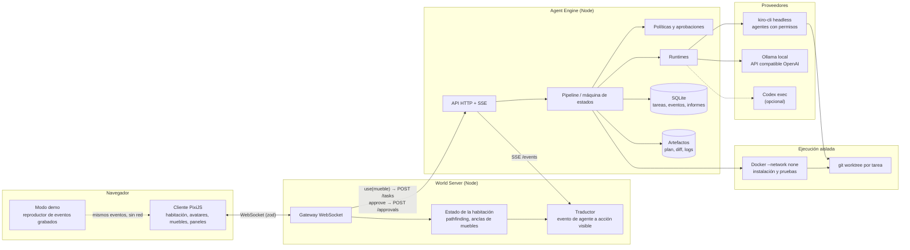
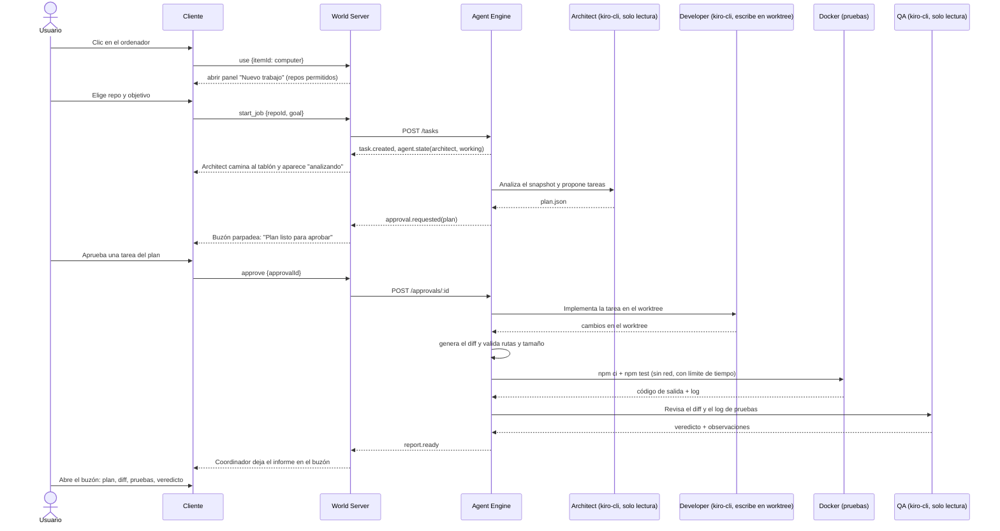

# AGENT LIFE — Propuesta de arquitectura

## Decisión

El sistema se compone de un monorepo pnpm con cuatro paquetes y dos procesos Node:

- **World Server**: el mundo virtual.
- **Agent Engine**: el trabajo real de los agentes.

El cliente web solo habla con el World Server. El World Server solo conoce los eventos del Agent Engine, no sus proveedores de modelos.

## Componentes

| Capa | Paquete o proceso | Responsabilidad | Lo que no hace |
|---|---|---|---|
| 1. Cliente visual | `packages/client` (Vite + PixiJS) | Dibujar la habitación, los avatares, los muebles, los bocadillos y los paneles. Enviar intenciones del usuario (moverse, usar un mueble, aprobar). | No contiene lógica de IA ni decide el estado de un agente. |
| 2. World Server | `packages/world-server` (Node, `ws`) | Estado de la habitación, pathfinding, posiciones de avatares y agentes. Traducir eventos de agentes en acciones visibles ("Developer camina al escritorio y se pone a trabajar"). Traducir el uso de muebles en órdenes al Agent Engine. | No llama a modelos ni ejecuta código. |
| 3. Agent Engine | `packages/agent-engine` (Node) | Tareas, pipeline, roles, runtimes de agentes, permisos, aprobaciones, artefactos y registro de eventos. | No sabe nada de casillas, sprites ni habitaciones. |
| 4. Proveedores de modelos | Adaptadores dentro de Agent Engine | `KiroCliRuntime` (`kiro-cli` headless), `LlmRuntime` (API compatible con OpenAI: Ollama u otros) y, opcionalmente, `CodexRuntime`. | |
| 5. Integraciones | Fuera del MVP en el producto | Discord (vía Kiro Crew o webhook) y GitHub (PR). En el MVP se usan en el flujo de desarrollo, no dentro del producto. | |
| 6. Persistencia | SQLite en Agent Engine y artefactos en disco | Tareas, ejecuciones, eventos (append-only), aprobaciones e informes. Diffs y logs en `data/runs/<id>/`. | El World Server no tiene base de datos en el MVP: la habitación se define en JSON. |
| 7. Seguridad | Agent Engine | Repositorios de una lista permitida, worktree por tarea, permisos por rol, aprobación humana y pruebas en Docker sin red. | |
| Compartido | `packages/shared` | Esquemas zod del protocolo de cliente y de los eventos de agente, y la geometría isométrica. | |

## Diagrama

## Del clic en el ordenador al informe en el buzón

## Contratos

### Agent Engine: API HTTP

| Método | Ruta | Uso |
|---|---|---|
| `GET` | `/repos` | Repositorios de la lista permitida |
| `POST` | `/tasks` | `{repoId, goal}` crea un trabajo |
| `GET` | `/tasks/:id` | Estado, artefactos y aprobaciones pendientes |
| `POST` | `/approvals/:id` | `{decision: "approve" \| "reject", note?}` |
| `POST` | `/tasks/:id/cancel` | Cancela y mata los procesos hijo |
| `GET` | `/events?since=<seq>` | SSE con el flujo ordenado de eventos. `since` permite reconectar sin perder eventos. |
| `GET` | `/tasks/:id/export` | Registro de eventos en JSON para el modo demo |

### Eventos de agente

Viven en `shared` y están validados con zod. Cada evento lleva `seq`, `ts`, `taskId` y `agentId?`.

- `task.created`, `task.state_changed`, `task.failed`, `task.completed`
- `agent.state_changed`: `idle | walking | thinking | working | waiting_approval | blocked | done | error`, con un texto corto opcional
- `agent.goto`: un **ancla semántica**, no una casilla: `desk`, `board`, `computer`, `mailbox`, `lab`
- `agent.say`: frase corta para el bocadillo
- `artifact.created`: `plan`, `diff`, `test_log`, `review`, `report`
- `approval.requested`, `approval.resolved`
- `report.ready`

El Agent Engine habla de anclas semánticas y el World Server las resuelve a casillas según la habitación. Así se puede rediseñar la habitación o sustituir el cliente sin tocar el motor.

### Muebles como interfaz

Cada mueble del catálogo declara una `interaction`. En el MVP solo se implementan `computer`, `mailbox` y `board`. El World Server resuelve la interacción y abre un panel en el cliente o llama al Agent Engine. El mueble no contiene lógica de IA.

| Mueble | Interacción en el MVP | Llamada |
|---|---|---|
| Ordenador | Abre "Nuevo trabajo" | `GET /repos`, `POST /tasks` |
| Buzón | Lista informes y aprobaciones | `GET /tasks/:id`, `POST /approvals/:id` |
| Tablón | Estado del trabajo en curso | Lectura de eventos |

## Modo demo para los jueces

1. Una ejecución real en local se exporta con `GET /tasks/:id/export` a `client/public/demo/run-001.json`, con sus artefactos.
2. El cliente tiene dos transportes con la misma interfaz: `LiveTransport` (WebSocket) y `ReplayTransport`. Este último lee el JSON y emite los eventos con su ritmo original (o acelerado) y simula las acciones del World Server en el propio navegador.
3. La versión publicada abre en modo demo y lo indica en pantalla: "Replay of a real run recorded on <fecha>".

Esto da una URL que siempre funciona, sin costes ni riesgo de ejecutar código ajeno en un servidor público, y conserva la verificabilidad: el diff y el log de pruebas son los reales.

## Por qué así

- **Dos procesos en lugar de uno:** el requisito de que el Agent Engine sea independiente se cumple con una frontera real (HTTP + SSE), no solo con módulos. Coste: unas decenas de líneas de cliente HTTP y SSE.
- **Anclas semánticas:** el motor no depende del mundo.
- **Registro de eventos append-only:** da observabilidad, reconexión y modo demo con un único mecanismo.
- **Alternativa considerada, un único proceso:** es más simple, pero mezcla el ciclo de vida de los procesos de agentes (largos, que pueden colgarse) con el bucle del mundo. **Cambiaría de opinión** si el tiempo aprieta: se pueden ejecutar los dos en el mismo proceso detrás de la misma interfaz y separarlos después.
